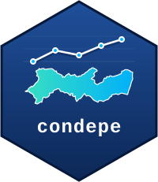

# condepe 

Acesso, pelo R, aos dados abertos do **Observatório de Pernambuco**, publicados
pela [Condepe/Fidem](https://cf.pe.gov.br) (Agência Estadual de Planejamento e
Pesquisas de Pernambuco): séries municipais de população, economia, finanças
públicas, trabalho, educação, saúde, segurança, transporte e meio ambiente para
os 185 municípios de Pernambuco.

Todas as fontes são publicadas no mesmo formato longo (uma observação por
linha, 15 colunas), e por isso um único conjunto de funções atende a todas,
devolvendo tibbles.

## Instalação

```r
install.packages("condepe")   # quando estiver no CRAN

# versão em desenvolvimento:
# install.packages("pak")
pak::pak("StrategicProjects/condepe-r")
```

## Uso

```r
library(condepe)

# Fontes disponíveis (uma por linha) e a versão do catálogo
cat <- condepe_catalog()
attr(cat, "version")

# Indicadores de uma fonte
condepe_indicators("sidra_populacao_estimada")

# Uma série: Recife (IBGE 2611606), de 2020 em diante
condepe_series(
  "sidra_populacao_estimada", "Populacao residente estimada",
  code = "2611606", years = 2020:2026
)

# Uma fonte inteira e a lista de municípios
condepe_data("datasus_sinasc")
condepe_localities()
```

Os nomes das colunas ficam em português, como publicados, para que todo
resultado possa ser rastreado até os arquivos oficiais: `cd_municipio_ibge`,
`nm_municipio`, `ano`, `mes`, `indicador`, `indicador_base`, `valor`,
`unidade`, `natureza`, `id_fonte`, `eixo`, `tema`, `assunto`, `fonte_original`,
`arquivo_origem`. Séries mensais trazem o período em `indicador`
(`"... [MM/AAAA]"`) e em `mes`; `indicador_base` é o rótulo sem ele.

Guias: [primeiros passos](https://strategicprojects.github.io/condepe-r/articles/condepe.html),
[exemplos](https://strategicprojects.github.io/condepe-r/articles/exemplos.html),
[mapas](https://strategicprojects.github.io/condepe-r/articles/mapas.html) e a
[relação das fontes](https://strategicprojects.github.io/condepe-r/articles/fontes.html).

## De onde vêm os dados

- **Canônico:** <https://cf.pe.gov.br/observatorio/dados/atual/>
- **Espelho (reserva):** o dataset do Hugging Face
  [`mlkwy/observatorio-pernambuco`](https://huggingface.co/datasets/mlkwy/observatorio-pernambuco),
  com os mesmos caminhos.

Os arquivos ficam em cache em disco por versão do catálogo
(`condepe_cache_dir()`) e são conferidos pelo SHA-256 publicado no catálogo; o
catálogo vale por 6 horas. Se nenhum dos dois endereços responder, as funções
avisam e devolvem um tibble vazio com as colunas documentadas. As opções estão
em `?condepe`.

## Citação e licença

Dados: Condepe/Fidem, *Observatório de Pernambuco — Base de Dados do Estado*,
[CC BY 4.0](https://creativecommons.org/licenses/by/4.0/deed.pt-br). A citação
com a versão em uso está em `attr(condepe_catalog(), "citation")`.

Código: MIT. Para ler ou gravar buckets *privados* do `s3.pe.gov.br` com chave
de acesso, veja o [`s3pe`](https://github.com/StrategicProjects/s3pe); o
`condepe` não precisa de chave, porque os dados abertos do Observatório são
públicos. Há um pacote Python com as mesmas funções:
[`condepe` para Python](https://github.com/StrategicProjects/condepe-py).
