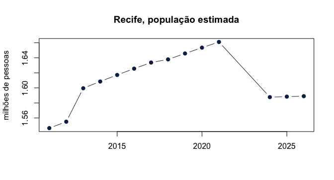

# Primeiros passos

O **Observatório de Pernambuco** é a base de dados estatísticos da
Condepe/Fidem, a Agência Estadual de Planejamento e Pesquisas de
Pernambuco. Ele reúne séries do IBGE, dos ministérios da Saúde, da
Educação, do Trabalho e da Fazenda, da Justiça Eleitoral, de órgãos
estaduais e de outras fontes, para os 185 municípios de Pernambuco e
para o Estado. A consulta pelo navegador fica em
<https://cf.pe.gov.br/observatorio>; os arquivos completos, em
<https://cf.pe.gov.br/observatorio/dados/atual/>.

Todas as fontes são publicadas no **mesmo formato longo** — uma
observação por linha, 15 colunas —, e por isso meia dúzia de funções dá
conta de todas:

| Função | Para quê |
|----|----|
| [`condepe_catalog()`](https://strategicprojects.github.io/condepe-r/reference/condepe_catalog.md) | o que existe: as fontes, com tema, período e tamanho |
| [`condepe_indicators()`](https://strategicprojects.github.io/condepe-r/reference/condepe_indicators.md) | os indicadores de uma fonte |
| [`condepe_series()`](https://strategicprojects.github.io/condepe-r/reference/condepe_series.md) | a série de um indicador, filtrada por município e ano |
| [`condepe_data()`](https://strategicprojects.github.io/condepe-r/reference/condepe_data.md) | uma fonte inteira |
| [`condepe_localities()`](https://strategicprojects.github.io/condepe-r/reference/condepe_localities.md) | os municípios e seus códigos IBGE |

``` r

library(condepe)
```

## O que existe

[`condepe_catalog()`](https://strategicprojects.github.io/condepe-r/reference/condepe_catalog.md)
devolve uma linha por fonte. A relação completa, agrupada por eixo e
tema, está na vignette
[`vignette("fontes", package = "condepe")`](https://strategicprojects.github.io/condepe-r/articles/fontes.md).

``` r

cat <- condepe_catalog()
cat[, c("id_fonte", "tema", "indicadores", "ano_inicio", "ano_fim")]
#> # A tibble: 75 × 5
#>   id_fonte                 tema               indicadores ano_inicio ano_fim
#>   <chr>                    <chr>                    <int>      <int>   <int>
#> 1 sidra_populacao_estimada Demografia                   1       2001    2026
#> 2 sidra_pib_municipal      PIB                          7       2002    2023
#> 3 sidra_censo_2022         Demografia                   3       2022    2022
#> 4 sidra_area_densidade     Posição e Extensão           2       2010    2010
#> 5 sidra_pam                Agropecuária               243       2020    2025
#> 6 sidra_ppm_rebanho        Agropecuária                10       2020    2025
#> # ℹ 69 more rows
```

O catálogo é versionado: cada publicação do Observatório tem uma versão,
e a citação a usar acompanha o resultado.

``` r

attr(cat, "version")
#> [1] "2026-11-05_171049"
attr(cat, "citation")
#> [1] "Condepe/Fidem, Observatório de Pernambuco — Base de Dados do Estado, version 2026-11-05_171049, https://cf.pe.gov.br/observatorio (CC BY 4.0)."
```

Quantas fontes há em cada eixo, e quantos indicadores:

``` r

aggregate(cbind(fontes = 1, indicadores) ~ eixo, data = cat, FUN = sum)
#>             eixo fontes indicadores
#> 1       Economia     26       89374
#> 2 Infraestrutura      2          29
#> 3         Social     44       15060
#> 4     Território      3        9034
```

Para achar uma fonte por assunto, filtre o catálogo como qualquer
tabela:

``` r

cat[cat$tema == "Saúde", c("id_fonte", "descricao")]
#> # A tibble: 9 × 2
#>   id_fonte                    
#>   <chr>                       
#> 1 datasus_sim                 
#> 2 datasus_sinasc              
#> 3 datasus_mortalidade_infantil
#> 4 datasus_estabelecimentos    
#> 5 datasus_profissionais       
#> 6 datasus_leitos              
#> 7 datasus_equipamentos        
#> 8 datasus_equipes             
#> 9 datasus_internacoes         
#>   descricao                                                                     
#>   <chr>                                                                         
#> 1 Óbitos por residência (total, infantis, por causa e sexo) e por ocorrência    
#> 2 Nascidos vivos por residência (sexo, parto, peso, idade da mãe, pré-natal, pr…
#> 3 Taxa de mortalidade infantil (óbitos de menores de 1 ano por mil nascidos viv…
#> 4 Estabelecimentos de saúde por tipo de unidade                                 
#> 5 Vínculos de profissionais de saúde por ocupação (CBO); um profissional em doi…
#> 6 Leitos existentes, SUS e contratados por tipo; leitos de UTI por grupo (adult…
#> 7 Equipamentos de saúde em uso: total e grupos (tomógrafo, ressonância, mamógra…
#> 8 Equipes de saúde ativas em dezembro, total e por tipo (CNES-EP)               
#> 9 Internações hospitalares do SUS: mensais por especialidade (local de internaç…
cat[grepl("escola|ensino|IDEB", cat$descricao, ignore.case = TRUE), c("id_fonte", "descricao")]
#> # A tibble: 10 × 2
#>    id_fonte                             
#>    <chr>                                
#>  1 mte_rais                             
#>  2 mte_rais_historica                   
#>  3 inep_complexidade_de_gestao_da_escola
#>  4 inep_taxas_de_rendimento_escolar     
#>  5 inep_remuneracao_media_dos_docentes  
#>  6 inep_ideb_anos_iniciais              
#>  7 inep_ideb_anos_finais                
#>  8 inep_ideb_ensino_medio               
#>  9 inep_censo_escolar                   
#> 10 tse_perfil_eleitorado                
#>    descricao                                                                    
#>    <chr>                                                                        
#>  1 Vínculos formais ativos em 31/12 por município: total, sexo, escolaridade, f…
#>  2 RAIS histórica 1985–2017 por município: vínculos, admissões, desligamentos e…
#>  3 Indicador de complexidade de gestão da escola                                
#>  4 Taxas de rendimento escolar (aprovação, reprovação e abandono)               
#>  5 Remuneração média dos docentes da educação básica (RAIS × Censo Escolar)     
#>  6 IDEB por município - anos iniciais do ensino fundamental                     
#>  7 IDEB por município - anos finais do ensino fundamental                       
#>  8 IDEB por município - ensino médio                                            
#>  9 Censo Escolar: matrículas, docentes, turmas, salas, equipamentos e profissio…
#> 10 Perfil do eleitorado por município: gênero, faixa etária, escolaridade, esta…
```

## Os indicadores de uma fonte

``` r

condepe_indicators("datasus_mortalidade_infantil")
#> # A tibble: 1 × 8
#>   indicador_base                                        unidade               
#>   <chr>                                                 <chr>                 
#> 1 Taxa de mortalidade infantil (por mil nascidos vivos) Por mil nascidos vivos
#>   natureza mensal observacoes localidades ano_inicio ano_fim
#>   <chr>    <lgl>        <int>       <int>      <int>   <int>
#> 1 estoque  FALSE         1480         185       2017    2024
```

Fontes grandes têm centenas de indicadores; procure pelo nome:

``` r

ind <- condepe_indicators("datasus_sinasc")
ind$indicador_base
#>  [1] "Nascidos vivos por ocorrência - Total"                            
#>  [2] "Nascidos vivos por residência - Baixo peso (< 2.500g)"            
#>  [3] "Nascidos vivos por residência - Homens"                           
#>  [4] "Nascidos vivos por residência - Mães adolescentes (< 20 anos)"    
#>  [5] "Nascidos vivos por residência - Mulheres"                         
#>  [6] "Nascidos vivos por residência - Parto cesáreo"                    
#>  [7] "Nascidos vivos por residência - Parto vaginal"                    
#>  [8] "Nascidos vivos por residência - Pré-natal com 7 ou mais consultas"
#>  [9] "Nascidos vivos por residência - Prematuros (< 37 semanas)"        
#> [10] "Nascidos vivos por residência - Total"
```

A coluna `natureza` diz como somar no tempo: `estoque` é uma foto
(população, leitos em dezembro) e não se soma entre anos; `fluxo` é o
que aconteceu no período (nascimentos, internações) e se soma.

## Uma série

[`condepe_series()`](https://strategicprojects.github.io/condepe-r/reference/condepe_series.md)
filtra uma fonte por indicador e, se pedido, por código IBGE — 7 dígitos
para município, `"26"` para o Estado — e por ano. A população do Recife
(2611606):

``` r

recife <- condepe_series(
  "sidra_populacao_estimada", "Populacao residente estimada",
  code = "2611606", years = 2010:2026
)
recife[, c("nm_municipio", "ano", "valor", "unidade")]
#> # A tibble: 14 × 4
#>    nm_municipio   ano   valor unidade
#>    <chr>        <int>   <dbl> <chr>  
#>  1 Recife        2011 1546516 Pessoas
#>  2 Recife        2012 1555039 Pessoas
#>  3 Recife        2013 1599513 Pessoas
#>  4 Recife        2014 1608488 Pessoas
#>  5 Recife        2015 1617183 Pessoas
#>  6 Recife        2016 1625583 Pessoas
#>  7 Recife        2017 1633697 Pessoas
#>  8 Recife        2018 1637834 Pessoas
#>  9 Recife        2019 1645727 Pessoas
#> 10 Recife        2020 1653461 Pessoas
#> 11 Recife        2021 1661017 Pessoas
#> 12 Recife        2024 1587707 Pessoas
#> 13 Recife        2025 1588376 Pessoas
#> 14 Recife        2026 1588983 Pessoas
```

``` r

plot(
  recife$ano, recife$valor / 1e6, type = "b", pch = 19, col = "#0c2856",
  xlab = "", ylab = "milhões de pessoas", main = "Recife, população estimada"
)
```



plot of chunk populacao-recife

O IBGE não estimou a população municipal em 2022 e 2023 (ano do Censo e
o seguinte); esses anos simplesmente não aparecem — ausência nunca vira
zero.

Os códigos IBGE ficam em
[`condepe_localities()`](https://strategicprojects.github.io/condepe-r/reference/condepe_localities.md):

``` r

loc <- condepe_localities()
loc[grepl("Petrolina|Caruaru|Garanhuns", loc$nm_municipio), ]
#> # A tibble: 3 × 2
#>   cd_municipio_ibge nm_municipio
#>   <chr>             <chr>       
#> 1 2604106           Caruaru     
#> 2 2606002           Garanhuns   
#> 3 2611101           Petrolina
```

## Séries mensais

Fontes mensais trazem o período duas vezes: em `mes` e no rótulo
completo, `indicador` (`"... [MM/AAAA]"`). Filtre por `indicador_base`,
o rótulo sem o período:

``` r

suape <- condepe_series(
  "porto_suape_carga", "Porto de Suape - Carga bruta total",
  years = 2026
)
suape[, c("ano", "mes", "indicador", "valor", "unidade")]
#> # A tibble: 9 × 5
#>     ano   mes indicador                                       valor unidade
#>   <int> <int> <chr>                                           <dbl> <chr>  
#> 1  2026     1 Porto de Suape - Carga bruta total [01/2026] 2193515. t      
#> 2  2026     2 Porto de Suape - Carga bruta total [02/2026] 2084475. t      
#> 3  2026     3 Porto de Suape - Carga bruta total [03/2026] 2223492. t      
#> 4  2026     4 Porto de Suape - Carga bruta total [04/2026] 2360768. t      
#> 5  2026     5 Porto de Suape - Carga bruta total [05/2026] 2403538. t      
#> 6  2026     6 Porto de Suape - Carga bruta total [06/2026] 2445490. t      
#> 7  2026     7 Porto de Suape - Carga bruta total [07/2026] 2363978. t      
#> 8  2026     8 Porto de Suape - Carga bruta total [08/2026] 2726020. t      
#> 9  2026     9 Porto de Suape - Carga bruta total [09/2026] 2453353. t
```

## Uma fonte inteira e as colunas

[`condepe_data()`](https://strategicprojects.github.io/condepe-r/reference/condepe_data.md)
devolve a fonte completa. As 15 colunas mantêm os nomes com que o
Observatório publica, para que todo resultado possa ser rastreado até os
arquivos oficiais:

``` r

nasc <- condepe_data("datasus_sinasc")
names(nasc)
#>  [1] "cd_municipio_ibge" "nm_municipio"      "ano"              
#>  [4] "mes"               "indicador"         "indicador_base"   
#>  [7] "valor"             "unidade"           "natureza"         
#> [10] "id_fonte"          "eixo"              "tema"             
#> [13] "assunto"           "fonte_original"    "arquivo_origem"
```

| Coluna | Significado |
|----|----|
| `cd_municipio_ibge`, `nm_municipio` | código IBGE (7 dígitos; `"26"` é o Estado) e nome |
| `ano`, `mes` | ano; mês nas séries mensais (`NA` nas demais) |
| `indicador`, `indicador_base` | rótulo completo (com `[MM/AAAA]` se mensal) e rótulo sem o período |
| `valor`, `unidade`, `natureza` | valor, unidade, `estoque` ou `fluxo` |
| `id_fonte`, `eixo`, `tema`, `assunto` | a fonte e seu lugar no catálogo |
| `fonte_original`, `arquivo_origem` | órgão de origem e o arquivo ou a consulta de onde o valor veio |

Para passar ao formato largo (um indicador por coluna), use
[`reshape()`](https://rdrr.io/r/stats/reshape.html) ou
`tidyr::pivot_wider()`:

``` r

largo <- reshape(
  as.data.frame(nasc[nasc$ano == 2024 & grepl("^Nascidos vivos por residência - (Total|Parto)", nasc$indicador_base),
                     c("nm_municipio", "indicador_base", "valor")]),
  idvar = "nm_municipio", timevar = "indicador_base", direction = "wide"
)
head(largo)
#>             nm_municipio valor.Nascidos vivos por residência - Parto cesáreo
#> 1           Abreu e Lima                                                 499
#> 4  Afogados da Ingazeira                                                 348
#> 7                Afrânio                                                 143
#> 10             Agrestina                                                 221
#> 13            Água Preta                                                 138
#> 16           Águas Belas                                                 282
#>    valor.Nascidos vivos por residência - Parto vaginal
#> 1                                                  536
#> 4                                                  164
#> 7                                                   86
#> 10                                                 113
#> 13                                                 176
#> 16                                                 353
#>    valor.Nascidos vivos por residência - Total
#> 1                                         1037
#> 4                                          512
#> 7                                          229
#> 10                                         334
#> 13                                         314
#> 16                                         635
```

## Cache, espelho e falhas

Os arquivos são baixados uma vez por versão do catálogo e guardados em
[`condepe_cache_dir()`](https://strategicprojects.github.io/condepe-r/reference/condepe_cache_dir.md),
conferidos pelo SHA-256 publicado no catálogo; quando sai uma versão
nova, os arquivos antigos são apagados. O próprio catálogo vale por seis
horas (`refresh = TRUE` consulta de novo).

Os dados vêm do endereço canônico,
<https://cf.pe.gov.br/observatorio/dados/atual/>. Se ele não responder,
o pacote lê os mesmos arquivos do espelho no Hugging Face,
[`mlkwy/observatorio-pernambuco`](https://huggingface.co/datasets/mlkwy/observatorio-pernambuco).
Se nenhum responder, as funções avisam e devolvem tibbles vazios com as
colunas documentadas: o script degrada em vez de quebrar.

## Citação e licença

Os dados são publicados sob [CC BY
4.0](https://creativecommons.org/licenses/by/4.0/deed.pt-br): cite a
Condepe/Fidem e a versão (`attr(condepe_catalog(), "citation")`).
