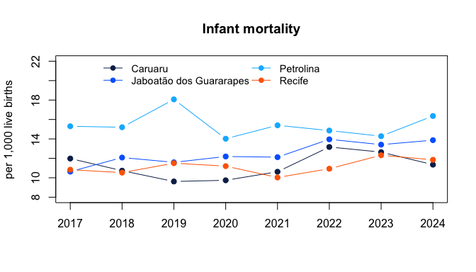
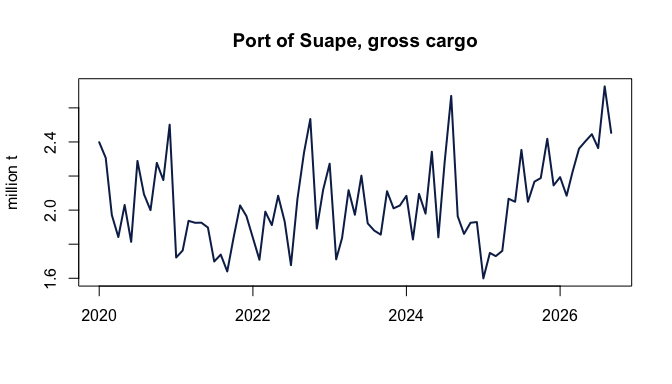

# Worked examples

``` r

library(condepe)
```

Base R graphics only, so the examples run with nothing but the package.

## Infant mortality in the largest cities

Infant mortality (deaths under one year per thousand live births, by
municipality of residence) for Recife, Jaboatão dos Guararapes, Caruaru
and Petrolina:

``` r

cidades <- c(
  Recife = "2611606", Jaboatao = "2607901",
  Caruaru = "2604106", Petrolina = "2611101"
)
tmi <- condepe_series(
  "datasus_mortalidade_infantil",
  "Taxa de mortalidade infantil (por mil nascidos vivos)",
  code = cidades
)
largo <- reshape(
  as.data.frame(tmi[, c("nm_municipio", "ano", "valor")]),
  idvar = "ano", timevar = "nm_municipio", direction = "wide"
)
largo
#>    ano valor.Caruaru valor.Jaboatão dos Guararapes valor.Petrolina valor.Recife
#> 1 2017         11.98                         10.63           15.30        10.83
#> 2 2018         10.73                         12.08           15.20        10.53
#> 3 2019          9.62                         11.59           18.07        11.50
#> 4 2020          9.74                         12.19           14.02        11.20
#> 5 2021         10.62                         12.12           15.40        10.03
#> 6 2022         13.17                         13.96           14.86        10.93
#> 7 2023         12.64                         13.41           14.28        12.32
#> 8 2024         11.35                         13.87           16.36        11.85
```

``` r

cores <- c("#0c2856", "#0068ff", "#00b7ff", "#ff6700")
matplot(
  largo$ano, largo[, -1], type = "b", pch = 19, lty = 1, col = cores,
  xlab = "", ylab = "per 1,000 live births", main = "Infant mortality",
  ylim = c(8, 22)
)
legend("top", sub("valor.", "", names(largo)[-1]), ncol = 2,
       col = cores, lty = 1, pch = 19, bty = "n", cex = 0.9)
```



plot of chunk tmi

## Cargo at the port of Suape

Monthly gross cargo handled at Suape (Ipojuca), in million tonnes:

``` r

suape <- condepe_series("porto_suape_carga", "Porto de Suape - Carga bruta total")
suape$data <- as.Date(sprintf("%d-%02d-01", suape$ano, suape$mes))
plot(
  suape$data, suape$valor / 1e6, type = "l", lwd = 2, col = "#0c2856",
  xlab = "", ylab = "million t", main = "Port of Suape, gross cargo"
)
```



plot of chunk suape

## IDEB of the municipal schools

The Basic Education Development Index (IDEB) of the early years of
elementary school, municipal network, for the State capital:

``` r

ind <- condepe_indicators("inep_ideb_anos_iniciais")
head(ind$indicador_base[grepl("^IDEB observado", ind$indicador_base)])
#> [1] "IDEB observado - Estadual"  "IDEB observado - Municipal"
#> [3] "IDEB observado - Pública"
ideb <- condepe_series(
  "inep_ideb_anos_iniciais", "IDEB observado - Municipal",
  code = "2611606"
)
ideb[, c("ano", "valor")]
#> # A tibble: 11 × 2
#>      ano valor
#>    <int> <dbl>
#>  1  2005   3.2
#>  2  2007   3.8
#>  3  2009   4.1
#>  4  2011   4.1
#>  5  2013   4.2
#>  6  2015   4.6
#>  7  2017   5  
#>  8  2019   5.2
#>  9  2021   5.3
#> 10  2023   5.5
#> 11  2025   5.8
```

## All municipalities in one year

Live births by municipality of residence in 2024, the ten largest:

``` r

nasc <- condepe_series(
  "datasus_sinasc", "Nascidos vivos por residência - Total",
  years = 2024
)
head(nasc[order(-nasc$valor), c("nm_municipio", "valor")], 10)
#> # A tibble: 10 × 2
#>    nm_municipio            valor
#>    <chr>                   <dbl>
#>  1 Recife                  16116
#>  2 Jaboatão dos Guararapes  7284
#>  3 Petrolina                6175
#>  4 Caruaru                  5285
#>  5 Olinda                   3879
#>  6 Paulista                 3284
#>  7 Cabo de Santo Agostinho  2435
#>  8 Garanhuns                1965
#>  9 Camaragibe               1711
#> 10 Vitória de Santo Antão   1622
```
