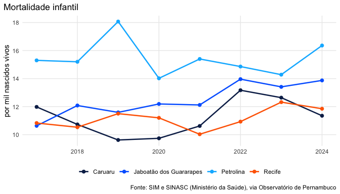
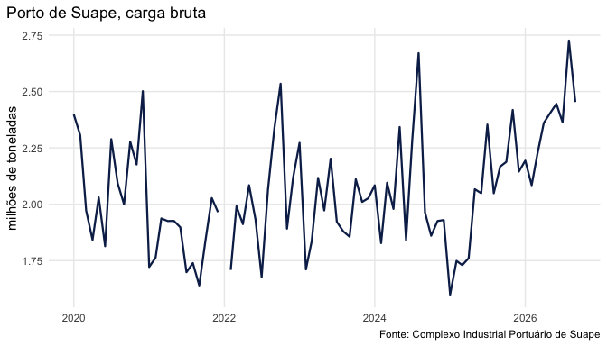
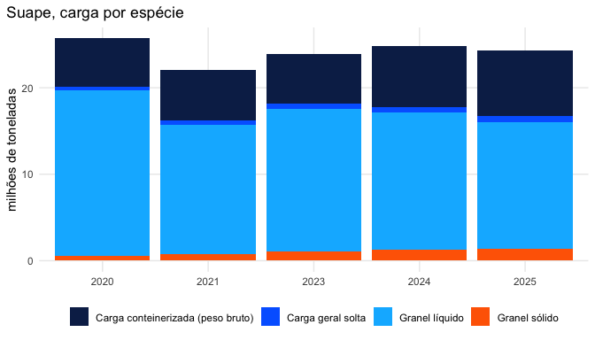
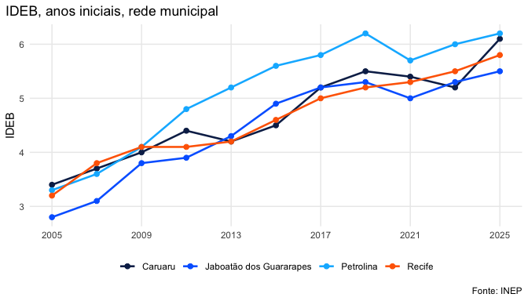
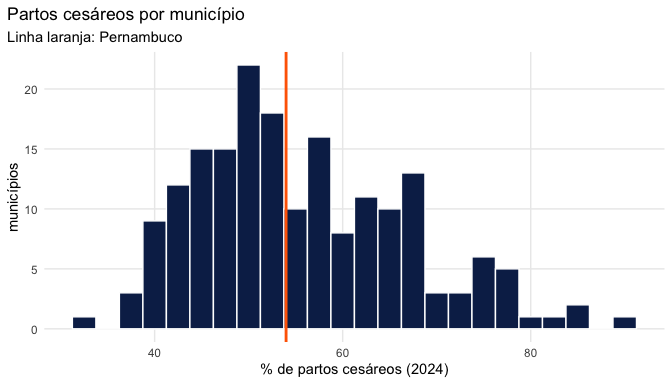

# Exemplos

``` r

library(condepe)
library(ggplot2)
```

Os gráficos usam `ggplot2`, que não é dependência do pacote
(`install.packages("ggplot2")`). As cores são as do Observatório: o azul
institucional de Pernambuco e os acentos da paleta oficial.

``` r

azul <- "#0c2856"
paleta <- c("#0c2856", "#0068ff", "#00b7ff", "#ff6700", "#ffce00")
tema <- theme_minimal(base_size = 11) +
  theme(plot.title.position = "plot", legend.position = "bottom",
        panel.grid.minor = element_blank())
```

## Mortalidade infantil nas maiores cidades

Óbitos de menores de um ano por mil nascidos vivos, por município de
residência:

``` r

cidades <- c("2611606", "2607901", "2604106", "2611101")
tmi <- condepe_series(
  "datasus_mortalidade_infantil",
  "Taxa de mortalidade infantil (por mil nascidos vivos)",
  code = cidades
)
tmi[tmi$ano == max(tmi$ano), c("nm_municipio", "ano", "valor")]
#> # A tibble: 4 × 3
#>   nm_municipio              ano valor
#>   <chr>                   <int> <dbl>
#> 1 Caruaru                  2024  11.4
#> 2 Jaboatão dos Guararapes  2024  13.9
#> 3 Petrolina                2024  16.4
#> 4 Recife                   2024  11.8
```

``` r

ggplot(tmi, aes(ano, valor, colour = nm_municipio)) +
  geom_line(linewidth = 0.9) + geom_point(size = 2) +
  scale_colour_manual(values = paleta, name = NULL) +
  labs(x = NULL, y = "por mil nascidos vivos",
       title = "Mortalidade infantil",
       caption = "Fonte: SIM e SINASC (Ministério da Saúde), via Observatório de Pernambuco") +
  tema
```



plot of chunk tmi

## Carga movimentada no Porto de Suape

Carga bruta mensal em Suape (Ipojuca), em milhões de toneladas. Janeiro
de 2022 não foi publicado pelo porto e aparece como lacuna:

``` r

suape <- condepe_series("porto_suape_carga", "Porto de Suape - Carga bruta total")
suape$data <- as.Date(sprintf("%d-%02d-01", suape$ano, suape$mes))
todos <- data.frame(data = seq(min(suape$data), max(suape$data), by = "month"))
suape <- merge(todos, suape, all.x = TRUE)
ggplot(suape, aes(data, valor / 1e6)) +
  geom_line(colour = azul, linewidth = 0.8) +
  labs(x = NULL, y = "milhões de toneladas", title = "Porto de Suape, carga bruta",
       caption = "Fonte: Complexo Industrial Portuário de Suape") +
  tema
```



plot of chunk suape

Carga por espécie em cada ano com os 12 meses publicados (2022, sem
janeiro, e o ano corrente ficam de fora: somariam menos meses):

``` r

especies <- c("Granel líquido", "Granel sólido", "Carga conteinerizada (peso bruto)", "Carga geral solta")
d <- condepe_series("porto_suape_carga", paste("Porto de Suape -", especies))
meses <- tapply(d$mes, d$ano, function(m) length(unique(m)))
d <- d[d$ano %in% as.integer(names(meses)[meses == 12]), ]
anual <- aggregate(valor ~ ano + indicador_base, data = d, FUN = sum)
anual$especie <- sub("Porto de Suape - ", "", anual$indicador_base)
ggplot(anual, aes(factor(ano), valor / 1e6, fill = especie)) +
  geom_col() +
  scale_fill_manual(values = paleta, name = NULL) +
  labs(x = NULL, y = "milhões de toneladas", title = "Suape, carga por espécie") +
  tema
```



plot of chunk suape-especies

## IDEB das escolas municipais

O Índice de Desenvolvimento da Educação Básica dos anos iniciais do
ensino fundamental, rede municipal, nas quatro cidades:

``` r

ideb <- condepe_series(
  "inep_ideb_anos_iniciais", "IDEB observado - Municipal", code = cidades
)
ggplot(ideb, aes(ano, valor, colour = nm_municipio)) +
  geom_line(linewidth = 0.9) + geom_point(size = 2) +
  scale_colour_manual(values = paleta, name = NULL) +
  scale_x_continuous(breaks = seq(2005, 2025, 4)) +
  labs(x = NULL, y = "IDEB", title = "IDEB, anos iniciais, rede municipal",
       caption = "Fonte: INEP") +
  tema
```



plot of chunk ideb

## Todos os municípios num ano

Nascidos vivos por município de residência em 2024, os dez maiores:

``` r

nasc <- condepe_series(
  "datasus_sinasc", "Nascidos vivos por residência - Total", years = 2024
)
head(nasc[order(-nasc$valor), c("nm_municipio", "valor")], 10)
#> # A tibble: 10 × 2
#>    nm_municipio            valor
#>    <chr>                   <dbl>
#>  1 Recife                  16116
#>  2 Jaboatão dos Guararapes  7284
#>  3 Petrolina                6175
#>  4 Caruaru                  5285
#>  5 Olinda                   3879
#>  6 Paulista                 3284
#>  7 Cabo de Santo Agostinho  2435
#>  8 Garanhuns                1965
#>  9 Camaragibe               1711
#> 10 Vitória de Santo Antão   1622
```

Proporção de partos cesáreos no mesmo ano, cruzando dois indicadores da
mesma fonte:

``` r

ind <- c("Nascidos vivos por residência - Total", "Nascidos vivos por residência - Parto cesáreo")
d <- condepe_series("datasus_sinasc", ind, years = 2024)
total <- d[d$indicador_base == ind[[1]], c("cd_municipio_ibge", "valor")]
cesareo <- d[d$indicador_base == ind[[2]], c("cd_municipio_ibge", "valor")]
w <- merge(total, cesareo, by = "cd_municipio_ibge", suffixes = c("_total", "_cesareo"))
w$pct <- 100 * w$valor_cesareo / w$valor_total
summary(w$pct)
#>    Min. 1st Qu.  Median    Mean 3rd Qu.    Max. 
#>   33.70   47.40   53.64   55.73   63.30   88.89
ggplot(w, aes(pct)) +
  geom_histogram(binwidth = 2.5, fill = azul, colour = "white") +
  geom_vline(xintercept = 100 * sum(w$valor_cesareo) / sum(w$valor_total), colour = "#ff6700", linewidth = 1) +
  labs(x = "% de partos cesáreos (2024)", y = "municípios",
       title = "Partos cesáreos por município", subtitle = "Linha laranja: Pernambuco") +
  tema
```



plot of chunk cesareas
