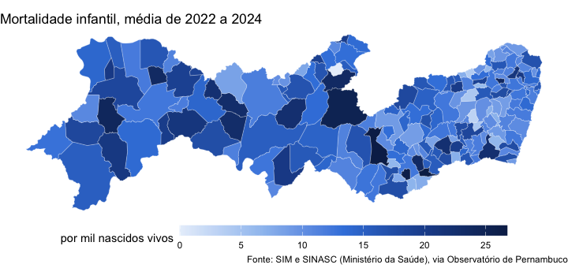
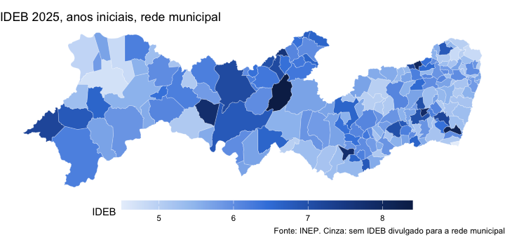
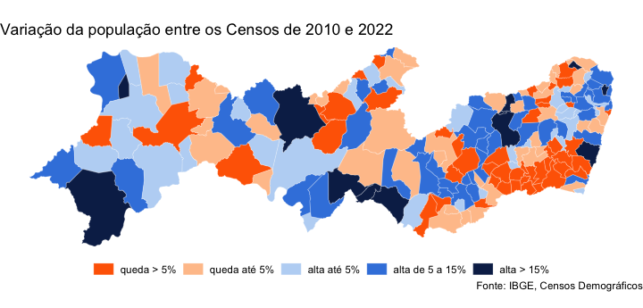
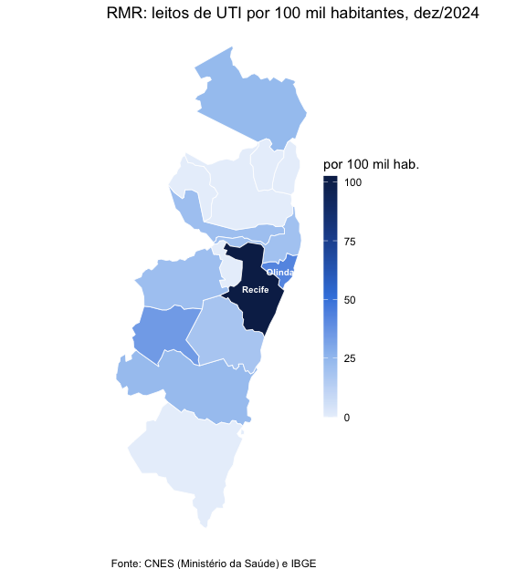

# Mapas

Toda observação do Observatório traz o código IBGE do município
(`cd_municipio_ibge`), e isso basta para juntar os dados a uma malha
municipal e fazer mapas. Esta vignette usa `sf` e `ggplot2`, que não são
dependências do pacote:

``` r

install.packages(c("sf", "ggplot2"))
```

``` r

library(condepe)
library(sf)
library(ggplot2)
```

## A malha municipal

A malha vem da API de malhas do IBGE, em GeoJSON, com o código do
município na propriedade `codarea` — o mesmo código de
`cd_municipio_ibge`. A qualidade intermediária é leve (cerca de 200 KB
para Pernambuco) e suficiente para mapas do estado inteiro:

``` r

url <- paste0(
  "https://servicodados.ibge.gov.br/api/v3/malhas/estados/26",
  "?formato=application/vnd.geo%2Bjson&intrarregiao=municipio&qualidade=intermediaria"
)
malha <- read_sf(url)
malha
#> Simple feature collection with 185 features and 1 field
#> Geometry type: MULTIPOLYGON
#> Dimension:     XY
#> Bounding box:  xmin: -41.3583 ymin: -9.4829 xmax: -32.3971 ymax: -3.8358
#> Geodetic CRS:  WGS 84
#> # A tibble: 185 × 2
#>   codarea
#>   <chr>  
#> 1 2600054
#> 2 2600104
#> 3 2600203
#> 4 2600302
#> 5 2600401
#> 6 2600500
#>                                                                         geometry
#>                                                               <MULTIPOLYGON [°]>
#> 1 (((-35.031 -7.9298, -35.0254 -7.9258, -35.0238 -7.9182, -35.0183 -7.9158, -34…
#> 2 (((-37.7048 -7.6169, -37.7001 -7.6244, -37.6898 -7.6337, -37.6801 -7.6454, -3…
#> 3 (((-41.3583 -8.7076, -41.3435 -8.722, -41.3344 -8.7277, -41.3209 -8.7282, -41…
#> 4 (((-35.9686 -8.5359, -35.9687 -8.5488, -35.9604 -8.5482, -35.9476 -8.5352, -3…
#> 5 (((-35.3416 -8.725, -35.4037 -8.7137, -35.3945 -8.6831, -35.474 -8.6279, -35.…
#> 6 (((-37.1691 -9.2657, -37.1643 -9.2757, -37.1424 -9.2681, -37.1299 -9.2601, -3…
#> # ℹ 179 more rows
```

Fernando de Noronha (2605459) fica a 545 km da costa; num mapa do estado
inteiro ele espreme o continente para a esquerda. Os mapas abaixo o
deixam de fora:

``` r

malha <- malha[malha$codarea != "2605459", ]
```

Um tema limpo para os mapas, nas cores do Observatório:

``` r

tema_mapa <- theme_void(base_size = 11) +
  theme(plot.title.position = "plot", legend.position = "bottom",
        legend.key.width = unit(2.2, "cm"), legend.key.height = unit(0.35, "cm"))
azuis <- c("#e8f0fb", "#9fc3f0", "#3d84df", "#1f4f9a", "#0c2856")
```

## Mortalidade infantil

A taxa de mortalidade infantil é ruidosa nos municípios pequenos (poucos
nascimentos por ano); a média de três anos é mais estável:

``` r

tmi <- condepe_series(
  "datasus_mortalidade_infantil",
  "Taxa de mortalidade infantil (por mil nascidos vivos)",
  years = 2022:2024
)
media <- aggregate(valor ~ cd_municipio_ibge, data = tmi, FUN = mean)
mapa <- merge(malha, media, by.x = "codarea", by.y = "cd_municipio_ibge", all.x = TRUE)
summary(mapa$valor)
#>    Min. 1st Qu.  Median    Mean 3rd Qu.    Max. 
#>    0.00   10.70   13.26   13.78   16.59   26.73
```

``` r

ggplot(mapa) +
  geom_sf(aes(fill = valor), colour = "white", linewidth = 0.08) +
  scale_fill_gradientn(colours = azuis, name = "por mil nascidos vivos", na.value = "grey85") +
  labs(title = "Mortalidade infantil, média de 2022 a 2024",
       caption = "Fonte: SIM e SINASC (Ministério da Saúde), via Observatório de Pernambuco") +
  tema_mapa
```



plot of chunk tmi

## IDEB das escolas municipais

``` r

ideb <- condepe_series(
  "inep_ideb_anos_iniciais", "IDEB observado - Municipal", years = 2025
)
mapa <- merge(malha, ideb[, c("cd_municipio_ibge", "valor")],
              by.x = "codarea", by.y = "cd_municipio_ibge", all.x = TRUE)
```

``` r

ggplot(mapa) +
  geom_sf(aes(fill = valor), colour = "white", linewidth = 0.08) +
  scale_fill_gradientn(colours = azuis, name = "IDEB", na.value = "grey85") +
  labs(title = "IDEB 2025, anos iniciais, rede municipal",
       caption = "Fonte: INEP. Cinza: sem IDEB divulgado para a rede municipal") +
  tema_mapa
```



plot of chunk ideb

## Variação: classes e divergência

Para uma variação, que tem sinal, a escala divergente deixa claro quem
cresceu e quem encolheu. Variação da população entre os Censos de 2010 e
2022 (as estimativas anuais não cobrem anos de Censo, e comparar
estimativas de antes e de depois do Censo de 2022 misturaria bases
diferentes):

``` r

pop <- condepe_series(
  "sidra_censo_cor_raca", "IBGE - População residente - Total",
  years = c(2010, 2022)
)
w <- reshape(as.data.frame(pop[, c("cd_municipio_ibge", "ano", "valor")]),
             idvar = "cd_municipio_ibge", timevar = "ano", direction = "wide")
w$var <- 100 * (w$valor.2022 / w$valor.2010 - 1)
w$classe <- cut(w$var, c(-Inf, -5, 0, 5, 15, Inf),
                labels = c("queda > 5%", "queda até 5%", "alta até 5%", "alta de 5 a 15%", "alta > 15%"))
mapa <- merge(malha, w, by.x = "codarea", by.y = "cd_municipio_ibge", all.x = TRUE)
table(mapa$classe)
#> 
#>      queda > 5%    queda até 5%     alta até 5% alta de 5 a 15%      alta > 15% 
#>              48              43              34              47              12
```

``` r

ggplot(mapa) +
  geom_sf(aes(fill = classe), colour = "white", linewidth = 0.08) +
  scale_fill_manual(values = c("#ff6700", "#ffc49a", "#bcd6f5", "#3d84df", "#0c2856"),
                    name = NULL, drop = FALSE) +
  labs(title = "Variação da população entre os Censos de 2010 e 2022",
       caption = "Fonte: IBGE, Censos Demográficos") +
  tema_mapa + theme(legend.key.width = unit(0.6, "cm"))
```



plot of chunk populacao

## Região Metropolitana do Recife

Para ver um recorte, filtre a malha antes de desenhar. Os 15 municípios
da Região Metropolitana do Recife (Goiana entrou em 2018) e os leitos de
UTI por 100 mil habitantes em dezembro de 2024:

``` r

rmr <- c("2600054", "2601052", "2602902", "2603454", "2606200", "2606804",
         "2607208", "2607604", "2607752", "2607901", "2609402", "2609600",
         "2610707", "2611606", "2613701")
uti <- condepe_series("datasus_leitos", "Leitos de UTI - Total", code = rmr, years = 2024)
pop <- condepe_series("sidra_populacao_estimada", "Populacao residente estimada",
                      code = rmr, years = 2024)
d <- merge(pop[, c("cd_municipio_ibge", "nm_municipio", "valor")],
           uti[, c("cd_municipio_ibge", "valor")],
           by = "cd_municipio_ibge", suffixes = c("_pop", "_uti"), all.x = TRUE)
d$valor_uti[is.na(d$valor_uti)] <- 0  # município sem leito no CNES-LT: zero leitos de UTI
d$por_100mil <- 1e5 * d$valor_uti / d$valor_pop
d[order(-d$por_100mil), c("nm_municipio", "valor_uti", "por_100mil")]
#>               nm_municipio valor_uti por_100mil
#> 14                  Recife      1627  102.47483
#> 12                  Olinda       155   42.41903
#> 11                  Moreno        20   34.69391
#> 5                   Goiana        20   23.48520
#> 3  Cabo de Santo Agostinho        50   23.04477
#> 15    São Lourenço da Mata        25   21.22980
#> 1             Abreu e Lima        22   21.16504
#> 13                Paulista        72   19.83690
#> 10 Jaboatão dos Guararapes       124   18.14763
#> 2                Araçoiaba         0    0.00000
#> 4               Camaragibe         0    0.00000
#> 6                 Igarassu         0    0.00000
#> 7                  Ipojuca         0    0.00000
#> 8        Ilha de Itamaracá         0    0.00000
#> 9               Itapissuma         0    0.00000
mapa <- merge(malha[malha$codarea %in% rmr, ], d, by.x = "codarea", by.y = "cd_municipio_ibge")
mapa$rotulo <- ifelse(mapa$por_100mil >= 40, mapa$nm_municipio, "")  # os demais, na tabela acima
```

``` r

ggplot(mapa) +
  geom_sf(aes(fill = por_100mil), colour = "white", linewidth = 0.3) +
  geom_sf_text(aes(label = rotulo), size = 2.6, colour = "white", fontface = "bold",
               fun.geometry = function(x) suppressWarnings(sf::st_point_on_surface(x))) +
  scale_fill_gradientn(colours = azuis, name = "por 100 mil hab.") +
  labs(title = "RMR: leitos de UTI por 100 mil habitantes, dez/2024",
       caption = "Fonte: CNES (Ministério da Saúde) e IBGE") +
  tema_mapa +
  theme(legend.position = "right", legend.key.width = unit(0.4, "cm"),
        legend.key.height = unit(1.4, "cm"))
```



plot of chunk rmr

Os leitos concentram-se no Recife, que atende pacientes de toda a
região: o indicador mede oferta no município, não acesso de quem mora
nele.
