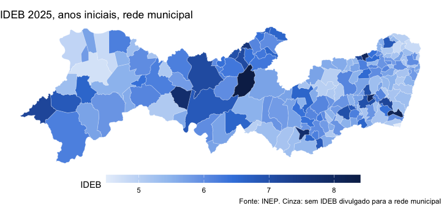
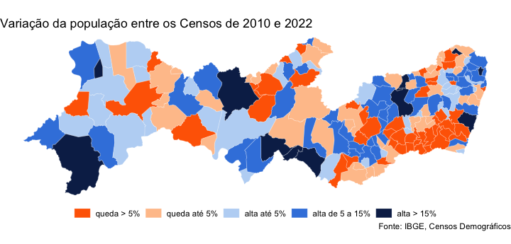
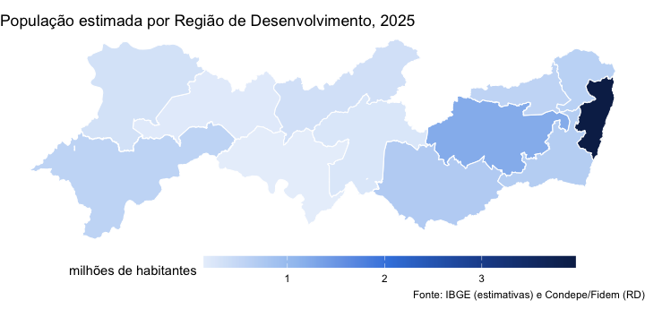
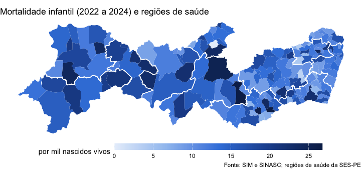
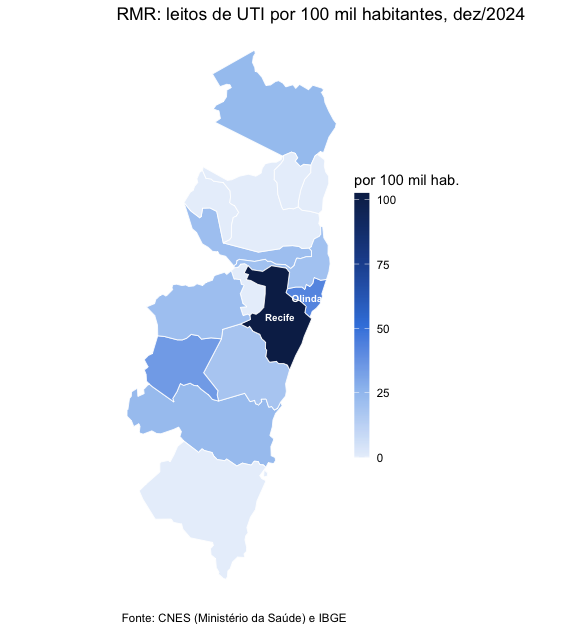

Toda observação do Observatório traz o código IBGE do município
(`cd_municipio_ibge`), e isso basta para juntar os dados a uma malha
municipal e fazer mapas. O pacote traz a malha (`condepe_geometry()`), a
junção (`condepe_add_geometry()`) e as regionalizações do estado
(`condepe_regions()`). Esta vignette usa `sf` e `ggplot2`, que não são
dependências obrigatórias do pacote:

```r
install.packages(c("sf", "ggplot2"))
```


``` r
library(condepe)
library(sf)
library(ggplot2)
```

## A malha municipal

`condepe_geometry()` baixa a Malha Municipal de Pernambuco publicada pela
Condepe/Fidem (a edição corrente, conferida pelo SHA-256 e guardada em
cache). Com `source = "ibge"`, a malha vem da API de malhas do IBGE.

Fernando de Noronha (2605459) fica a 545 km da costa; num mapa do estado
inteiro ele espreme o continente para a esquerda. Os mapas abaixo o deixam
de fora com `noronha = FALSE`:


``` r
malha <- condepe_geometry(noronha = FALSE)
attr(malha, "version")
#> [1] "2025-v3"
malha
#> Simple feature collection with 184 features and 2 fields
#> Geometry type: MULTIPOLYGON
#> Dimension:     XY
#> Bounding box:  xmin: -41.35834 ymin: -9.482897 xmax: -34.80669 ymax: -7.272954
#> Geodetic CRS:  WGS 84
#> First 10 features:
#>    cd_municipio_ibge          nm_municipio                       geometry
#> 1            2600054          Abreu e Lima MULTIPOLYGON (((-34.9148 -7...
#> 2            2600104 Afogados da Ingazeira MULTIPOLYGON (((-37.52795 -...
#> 3            2600203               Afrânio MULTIPOLYGON (((-40.76417 -...
#> 4            2600302             Agrestina MULTIPOLYGON (((-35.98255 -...
#> 5            2600401            Água Preta MULTIPOLYGON (((-35.5714 -8...
#> 6            2600500           Águas Belas MULTIPOLYGON (((-37.15559 -...
#> 7            2600609             Alagoinha MULTIPOLYGON (((-36.75877 -...
#> 8            2600708               Aliança MULTIPOLYGON (((-35.16596 -...
#> 9            2600807               Altinho MULTIPOLYGON (((-36.13812 -...
#> 10           2600906               Amaraji MULTIPOLYGON (((-35.39472 -...
```

Um tema limpo para os mapas, nas cores do Observatório:


``` r
tema_mapa <- theme_void(base_size = 11) +
  theme(plot.title.position = "plot", legend.position = "bottom",
        legend.key.width = unit(2.2, "cm"), legend.key.height = unit(0.35, "cm"))
azuis <- c("#e8f0fb", "#9fc3f0", "#3d84df", "#1f4f9a", "#0c2856")
```

## Mortalidade infantil

A taxa de mortalidade infantil é ruidosa nos municípios pequenos (poucos
nascimentos por ano); a média de três anos é mais estável:


``` r
tmi <- condepe_series(
  "datasus_mortalidade_infantil",
  "Taxa de mortalidade infantil (por mil nascidos vivos)",
  years = 2022:2024
)
media <- aggregate(valor ~ cd_municipio_ibge, data = tmi, FUN = mean)
mapa <- condepe_add_geometry(media, geometry = malha)
summary(mapa$valor)
#>    Min. 1st Qu.  Median    Mean 3rd Qu.    Max. 
#>    0.00   10.70   13.26   13.78   16.59   26.73
```


``` r
ggplot(mapa) +
  geom_sf(aes(fill = valor), colour = "white", linewidth = 0.08) +
  scale_fill_gradientn(colours = azuis, name = "por mil nascidos vivos", na.value = "grey85") +
  labs(title = "Mortalidade infantil, média de 2022 a 2024",
       caption = "Fonte: SIM e SINASC (Ministério da Saúde), via Observatório de Pernambuco") +
  tema_mapa
```

<div class="figure" style="text-align: center">

<p class="caption">plot of chunk tmi</p>
</div>

## IDEB das escolas municipais


``` r
ideb <- condepe_series(
  "inep_ideb_anos_iniciais", "IDEB observado - Municipal", years = 2025
)
mapa <- condepe_add_geometry(ideb, geometry = malha)
```


``` r
ggplot(mapa) +
  geom_sf(aes(fill = valor), colour = "white", linewidth = 0.08) +
  scale_fill_gradientn(colours = azuis, name = "IDEB", na.value = "grey85") +
  labs(title = "IDEB 2025, anos iniciais, rede municipal",
       caption = "Fonte: INEP. Cinza: sem IDEB divulgado para a rede municipal") +
  tema_mapa
```

<div class="figure" style="text-align: center">

<p class="caption">plot of chunk ideb</p>
</div>

## Variação: classes e divergência

Para uma variação, que tem sinal, a escala divergente deixa claro quem
cresceu e quem encolheu. Variação da população entre os Censos de 2010 e
2022 (as estimativas anuais não cobrem anos de Censo, e comparar estimativas
de antes e de depois do Censo de 2022 misturaria bases diferentes):


``` r
pop <- condepe_series(
  "sidra_censo_cor_raca", "IBGE - População residente - Total",
  years = c(2010, 2022)
)
w <- reshape(as.data.frame(pop[, c("cd_municipio_ibge", "ano", "valor")]),
             idvar = "cd_municipio_ibge", timevar = "ano", direction = "wide")
w$var <- 100 * (w$valor.2022 / w$valor.2010 - 1)
w$classe <- cut(w$var, c(-Inf, -5, 0, 5, 15, Inf),
                labels = c("queda > 5%", "queda até 5%", "alta até 5%", "alta de 5 a 15%", "alta > 15%"))
mapa <- condepe_add_geometry(w, geometry = malha)
table(mapa$classe)
#> 
#>      queda > 5%    queda até 5%     alta até 5% alta de 5 a 15%      alta > 15% 
#>              48              43              34              47              12
```


``` r
ggplot(mapa) +
  geom_sf(aes(fill = classe), colour = "white", linewidth = 0.08) +
  scale_fill_manual(values = c("#ff6700", "#ffc49a", "#bcd6f5", "#3d84df", "#0c2856"),
                    name = NULL, drop = FALSE) +
  labs(title = "Variação da população entre os Censos de 2010 e 2022",
       caption = "Fonte: IBGE, Censos Demográficos") +
  tema_mapa + theme(legend.key.width = unit(0.6, "cm"))
```

<div class="figure" style="text-align: center">

<p class="caption">plot of chunk populacao</p>
</div>

## Regiões

`condepe_regions()` diz a que região pertence cada município em onze
regionalizações: Regiões de Desenvolvimento (RD) da Condepe/Fidem, meso e
microrregiões e regiões imediatas e intermediárias do IBGE, regiões e
macrorregiões de saúde, Gerências Regionais de Educação (GRE), regiões
fiscais da SEFAZ, Diretorias Regionais de Operações (DRO) do DER e regiões
metropolitanas. A tabela é publicada pelo Observatório junto com os dados
abertos (`referencia/regioes.parquet`) e lida de lá com cache, como as fontes;
sem rede, vale a cópia que vai com o pacote (`offline = TRUE` força essa):


``` r
reg <- condepe_regions()
reg
#> # A tibble: 185 × 13
#>   cd_municipio_ibge nm_municipio          rd            mesorregiao microrregiao
#>   <chr>             <chr>                 <chr>         <chr>       <chr>       
#> 1 2600054           Abreu e Lima          Região Metro… Metropolit… Recife      
#> 2 2600104           Afogados da Ingazeira Sertão do Pa… Sertão Per… Pajeú       
#> 3 2600203           Afrânio               Sertão do Sã… São Franci… Petrolina   
#> 4 2600302           Agrestina             Agreste Cent… Agreste Pe… Brejo Perna…
#> 5 2600401           Água Preta            Mata Sul      Mata Perna… Mata Meridi…
#> 6 2600500           Águas Belas           Agreste Meri… Agreste Pe… Vale do Ipa…
#>   regiao_intermediaria regiao_imediata     regiao_saude macrorregiao_saude gre  
#>   <chr>                <chr>               <chr>        <chr>              <chr>
#> 1 Recife               Recife              I Região de… Metropolitana      Metr…
#> 2 Serra Talhada        Afogados da Ingaze… X Região de… Sertão             Sert…
#> 3 Petrolina            Petrolina           VIII Região… Vale do São Franc… Sert…
#> 4 Caruaru              Caruaru             IV Região d… Agreste            Agre…
#> 5 Recife               Palmares            III Região … Metropolitana      Mata…
#> 6 Caruaru              Garanhuns           V Região de… Agreste            Agre…
#> # ℹ 179 more rows
#> # ℹ 3 more variables: regiao_fiscal <chr>, dro <chr>, rm <chr>
table(reg$rd)
#> 
#>                Agreste Central             Agreste Meridional 
#>                             27                             26 
#>           Agreste Setentrional              Distrito Estadual 
#>                             19                              1 
#>                     Mata Norte                       Mata Sul 
#>                             19                             23 
#> Região Metropolitana do Recife                 Sertão Central 
#>                             14                              8 
#>            Sertão de Itaparica              Sertão do Araripe 
#>                              7                             10 
#>               Sertão do Moxotó                Sertão do Pajeú 
#>                              7                             17 
#>        Sertão do São Francisco 
#>                              7
```

Para mapear uma região, agregue os dados por região numa coluna `regiao` e
passe `level` a `condepe_add_geometry()`: a malha municipal é dissolvida na
regionalização pedida, com as mesmas divisas. População estimada de 2025 por
Região de Desenvolvimento:


``` r
pop <- condepe_series("sidra_populacao_estimada", "Populacao residente estimada",
                      years = 2025)
pop <- merge(pop, condepe_regions("rd")[, c("cd_municipio_ibge", "regiao")])
por_rd <- aggregate(valor ~ regiao, data = pop, FUN = sum)
por_rd[order(-por_rd$valor), ]
#>                            regiao   valor
#> 7  Região Metropolitana do Recife 3961730
#> 1                 Agreste Central 1214544
#> 2              Agreste Meridional  702044
#> 6                        Mata Sul  671469
#> 5                      Mata Norte  610969
#> 13        Sertão do São Francisco  569327
#> 3            Agreste Setentrional  567121
#> 12                Sertão do Pajeú  345392
#> 10              Sertão do Araripe  336359
#> 11               Sertão do Moxotó  251957
#> 8                  Sertão Central  184722
#> 9             Sertão de Itaparica  143032
#> 4               Distrito Estadual    3341
mapa <- condepe_add_geometry(por_rd, level = "rd", noronha = FALSE)
```


``` r
ggplot(mapa) +
  geom_sf(aes(fill = valor / 1e6), colour = "white", linewidth = 0.4) +
  scale_fill_gradientn(colours = azuis, name = "milhões de habitantes") +
  labs(title = "População estimada por Região de Desenvolvimento, 2025",
       caption = "Fonte: IBGE (estimativas) e Condepe/Fidem (RD)") +
  tema_mapa
```

<div class="figure" style="text-align: center">

<p class="caption">plot of chunk rd</p>
</div>

Os contornos das regiões também servem de camada sobre um mapa municipal.
Os municípios coloridos pela taxa de mortalidade infantil e, por cima, as
doze regiões de saúde (as Geres):


``` r
geres <- condepe_geometry("regiao_saude", noronha = FALSE)
ggplot() +
  geom_sf(data = condepe_add_geometry(media, geometry = malha),
          aes(fill = valor), colour = NA) +
  geom_sf(data = geres, fill = NA, colour = "white", linewidth = 0.5) +
  scale_fill_gradientn(colours = azuis, name = "por mil nascidos vivos", na.value = "grey85") +
  labs(title = "Mortalidade infantil (2022 a 2024) e regiões de saúde",
       caption = "Fonte: SIM e SINASC; regiões de saúde da SES-PE") +
  tema_mapa
```

<div class="figure" style="text-align: center">

<p class="caption">plot of chunk saude</p>
</div>

## Região Metropolitana do Recife

Para ver um recorte, filtre a malha antes de desenhar. Os 15 municípios da
Região Metropolitana do Recife (Goiana entrou em 2018) e os leitos de UTI por
100 mil habitantes em dezembro de 2024:


``` r
reg_rm <- condepe_regions("rm")
rmr <- reg_rm$cd_municipio_ibge[reg_rm$regiao %in% "Região Metropolitana do Recife"]
uti <- condepe_series("datasus_leitos", "Leitos de UTI - Total", code = rmr, years = 2024)
pop <- condepe_series("sidra_populacao_estimada", "Populacao residente estimada",
                      code = rmr, years = 2024)
d <- merge(pop[, c("cd_municipio_ibge", "nm_municipio", "valor")],
           uti[, c("cd_municipio_ibge", "valor")],
           by = "cd_municipio_ibge", suffixes = c("_pop", "_uti"), all.x = TRUE)
d$valor_uti[is.na(d$valor_uti)] <- 0  # município sem leito no CNES-LT: zero leitos de UTI
d$por_100mil <- 1e5 * d$valor_uti / d$valor_pop
d[order(-d$por_100mil), c("nm_municipio", "valor_uti", "por_100mil")]
#>               nm_municipio valor_uti por_100mil
#> 14                  Recife      1627  102.47483
#> 12                  Olinda       155   42.41903
#> 11                  Moreno        20   34.69391
#> 5                   Goiana        20   23.48520
#> 3  Cabo de Santo Agostinho        50   23.04477
#> 15    São Lourenço da Mata        25   21.22980
#> 1             Abreu e Lima        22   21.16504
#> 13                Paulista        72   19.83690
#> 10 Jaboatão dos Guararapes       124   18.14763
#> 2                Araçoiaba         0    0.00000
#> 4               Camaragibe         0    0.00000
#> 6                 Igarassu         0    0.00000
#> 7                  Ipojuca         0    0.00000
#> 8        Ilha de Itamaracá         0    0.00000
#> 9               Itapissuma         0    0.00000
mapa <- condepe_add_geometry(d, geometry = malha, all = FALSE)
mapa$rotulo <- ifelse(mapa$por_100mil >= 40, mapa$nm_municipio, "")  # os demais, na tabela acima
```


``` r
ggplot(mapa) +
  geom_sf(aes(fill = por_100mil), colour = "white", linewidth = 0.3) +
  geom_sf_text(aes(label = rotulo), size = 2.6, colour = "white", fontface = "bold",
               fun.geometry = function(x) suppressWarnings(sf::st_point_on_surface(x))) +
  scale_fill_gradientn(colours = azuis, name = "por 100 mil hab.") +
  labs(title = "RMR: leitos de UTI por 100 mil habitantes, dez/2024",
       caption = "Fonte: CNES (Ministério da Saúde) e IBGE") +
  tema_mapa +
  theme(legend.position = "right", legend.key.width = unit(0.4, "cm"),
        legend.key.height = unit(1.4, "cm"))
```

<div class="figure" style="text-align: center">

<p class="caption">plot of chunk rmr</p>
</div>

Os leitos concentram-se no Recife, que atende pacientes de toda a região:
o indicador mede oferta no município, não acesso de quem mora nele.
